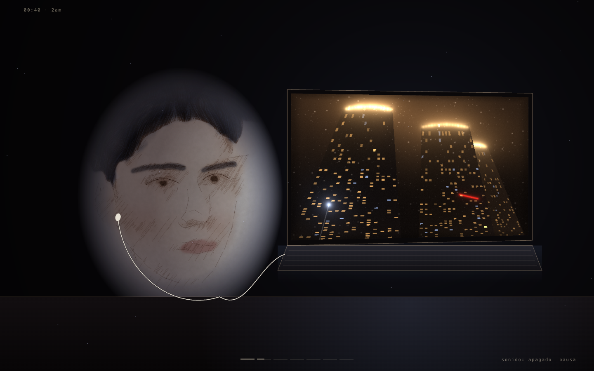

# constancia

animación web poética, un autorretrato para dejar constancia de lo que fue un ser humano. dura unos cuatro minutos, se reproduce sola y se puede avanzar con flechas, rueda o toque.



## verlo en local

```
python3 -m http.server 8765
```

y abrir http://localhost:8765. el sonido (ambiente generado, sin audio de terceros) está apagado por defecto.

## créditos

estilo de dibujo inspirado en los estudios de leonardo da vinci (dominio público). todo lo visual se dibuja con código propio.
