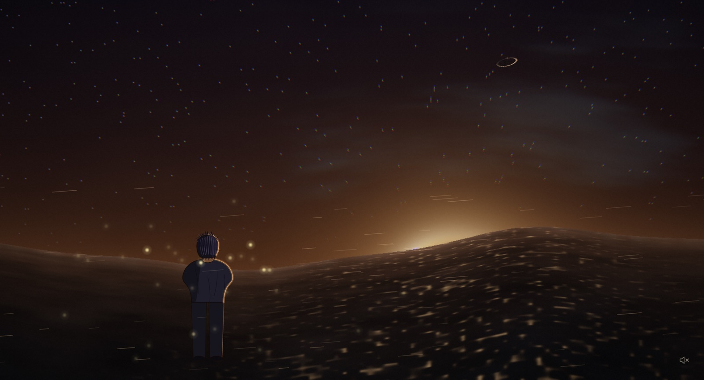

# fanal

motor de animación en canvas 2d y webgl2. animaciones largas en una sola toma, escritas como datos: cámara con dolly, paneo y parallax, transiciones por forma o por luz, partículas, shaders, dibujo a trazos, personajes por partes y sonido sintetizado. módulos es nativos, sin build y sin dependencias.

corre en el navegador (chrome, edge, safari) y se instala como app de escritorio en macos y windows.



**página:** https://kisnner26.github.io/fanal/

## instalar en escritorio

descarga la última versión desde [releases](https://github.com/kisnner26/fanal/releases/latest):

| sistema | archivo |
| --- | --- |
| macos apple silicon | `fanal-1.0.0-mac-arm64.dmg` |
| macos intel | `fanal-1.0.0-mac-x64.dmg` |
| windows x64 | `fanal-1.0.0-win-x64.zip` (portable: descomprimir y abrir `fanal.exe`) |

los ejecutables no están firmados. en macos, la primera vez: clic derecho sobre la app y abrir. en windows, si aparece smartscreen: más información y ejecutar de todas formas.

pantalla completa con f11 o cmd/ctrl+f, esc para salir.

## módulos

- `engine/timeline.js` secuenciador de tomas, easing y keyframes
- `engine/camera.js` cámara 2d, parallax y profundidad de campo
- `engine/transitions.js` fundidos, iris, match cuts y cruces de luz
- `engine/particles.js` luciérnagas, polillas, polvo y redes de neuronas
- `engine/strokes.js` dibujos a trazos con aguada y morph
- `engine/rig.js` personajes por partes con respiración, parpadeo y pelo con física
- `engine/gl.js` y `engine/shaders.js` pases webgl2 registrables: agujero negro lensado, julia, cielo y océano
- `engine/audio.js` grafo webaudio por capas con compresor, reverb y automatización
- `engine/player.js` une todo y reproduce una escena

la api de cada módulo está en [engine/README.md](engine/README.md).

## una escena son datos

```js
// scenes/mi-escena.js
import { fireflies } from '../engine/particles.js';

export default {
  name: 'mi-escena',
  shots: [{
    id: 'luces', dur: 10, camera: [{ t: 0, z: 1 }, { t: 10, z: 1.3 }],
    draw(S, env) {
      env.ctx.fillStyle = '#0a0705';
      env.ctx.fillRect(0, 0, S.w, S.h);
      fireflies(env.ctx, S.view, S.ta, { n: 20 });
    },
  }],
};
```

1. crea `scenes/<nombre>.js` con una lista de tomas (`shots`), cada una con su duración y su función `draw`.
2. ábrela con `teaser.html?escena=<nombre>`.
3. hay una escena mínima funcionando en [ejemplo.html](ejemplo.html).

## correr en local

```
python3 -m http.server 8791
```

en windows: `py -3 -m http.server 8791`. abre http://localhost:8791.

## compilar el escritorio

```
npm install
npm start
npm run build:mac
npm run build:win
```

`build:mac` genera dmg y zip (arm64 y x64) sin firmar; `build:win` genera un zip portable x64 y no necesita una pc con windows. detalles en [engine/README.md](engine/README.md).

## teaser: constancia

[`teaser.html`](https://kisnner26.github.io/fanal/teaser.html) es una muestra de lo que el motor puede hacer, no el proyecto: una animación sin texto de unos tres minutos, hecha solo con la api de fanal. una luciérnaga, una mente, un rostro a lo largo de la vida, un ojo, un agujero negro y un amanecer lejano. un clic en la luciérnaga la empieza; la escena está en `scenes/constancia.js`.

## créditos

el estilo de dibujo del teaser está inspirado en los estudios de leonardo da vinci (dominio público).
